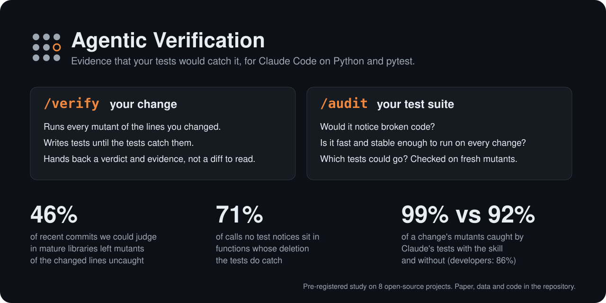
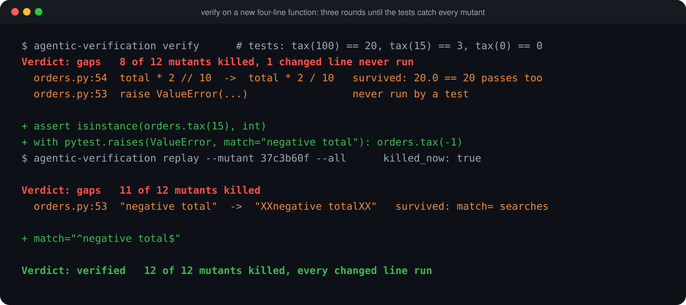
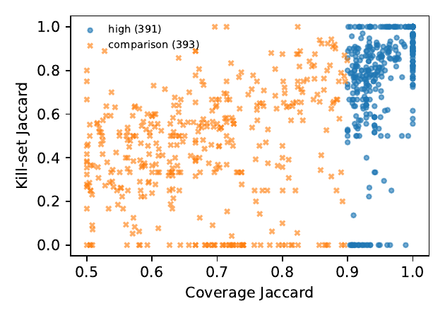

<p align="center"></p>

# Agentic Verification

**Passing tests are not evidence that your code is tested. Agentic Verification shows you what the tests would miss, and has Claude fix it.**

Coding agents now write code faster than anyone can review it. As Addy Osmani argues in [Agentic Verification](https://addyo.substack.com/p/agentic-verification), the bottleneck has moved from writing code to checking it. The way through is a check the agent can run itself, so that people review evidence instead of diffs. That only works if the tests can tell a correct change from a plausible wrong one.

This Claude Code plugin measures that directly for Python and pytest. It makes small, deliberate breakages ("mutants") in a disposable copy of your project and checks which ones the tests notice. It has two skills:

| | `/agentic-verification:verify` | `/agentic-verification:audit` |
|---|---|---|
| Use it | after Claude writes or changes code | on an existing test suite |
| It answers | Would the tests fail if this change were wrong? | Does the suite catch broken code? Is it fast and stable enough to run on every change? Which tests could go? |
| It does | Runs every mutant of the changed lines, writes tests until the tests catch them, checks them against the old code, and gives a verdict: verified, gaps or incomplete | Reports surviving mutants, tests that catch nothing, slow, flaky and order-dependent tests, and a removal set that it checks on fresh mutants before suggesting anything |
| Changes your code | Adds tests. It is told never to edit production code or weaken a test | No. Report-only |

## What it finds

Measured on eight mature open-source Python libraries, in studies registered before any data was collected:

- **Tested code is not checked code.** In recent upstream commits, 46% of the changes we could judge left mutants of the changed lines that the project's own tests did not catch. 71% of the calls that can be deleted without any test noticing sit inside functions whose deletion the tests do catch.
- **Claude writes stronger tests with the skill.** On 14 real commits with the developers' tests removed, Claude's tests caught 99% of the mutants of the change with the skill, against 92% without it. The developers' own tests caught 86%. 12 of 14 runs ended verified with the skill, against 9 without it and 5 for the developers' tests.
- **It keeps out of your working tree.** To see a test fail on the old code, Claude stashed the user's change in place in 11 of 14 runs without the skill, and 4 of 14 with it. The skill now uses `base-check`, which does that comparison in a copy.
- **It does not guess at redundancy.** Tests that run the same lines often catch different bugs (35% of near-identical pairs), and removal sets chosen from one mutant sample lost about 8% of kills on fresh mutants. So the audit only proposes removals, and checks them.

It is not magic. With or without the skill, Claude's tests caught the real behaviour change in nearly every task (13 and 14 of 14). The skill's advantage is in what those tests let through: most of the gaps the skill runs closed were error messages that a loose `match=` accepted.

<p align="center"></p>

The example above is a real run on a new four-line function. The first tests passed and looked fine. `verify` showed that replacing `//` with `/` still passed, because `20.0 == 20` in Python, and that the error branch never ran. Two rounds later every mutant was caught.

## Install

```text
/plugin marketplace add timini/agentic-verification
/plugin install agentic-verification@agentic-verification
```

Your project's environment needs Python 3.12+ and `pytest-cov`, plus `pytest-randomly` for order checks. Claude runs the runner through `uvx`, so nothing else needs installing.

## Use

```text
/agentic-verification:verify                 # uncommitted changes
/agentic-verification:verify --base main     # a whole branch
/agentic-verification:audit quick            # 5 minutes: timings, coverage, flakiness
/agentic-verification:audit deep             # 30 minutes: mutants, weak tests, removal set
```

Claude also picks these up without the slash command: ask it to check that a change is tested, or to audit, speed up or prune a test suite.

### In CI

The repository is also a GitHub Action. It fails a pull request whose changed lines contain mutants that no test catches, and writes the report to the job summary:

```yaml
- uses: actions/checkout@v4
  with: { fetch-depth: 0 }
- run: pip install -e . pytest pytest-cov
- uses: timini/agentic-verification@v0.3.0
  with:
    budget-minutes: 15
```

### Without Claude

The runner is a normal command-line tool:

```bash
uvx --from "git+https://github.com/timini/agentic-verification@v0.3.0#subdirectory=runner" agentic-verification --help
```

| Command | What it does |
|---|---|
| `verify [path] --base REV` | Every mutant on lines changed since `REV`; verdict and the fastest test command covering the change. `--fail-on-gaps` for hooks and CI. |
| `quick [path]` | Baseline run, timings, per-test coverage, overlap. No mutants. |
| `deep [path]` | Repeated and random-order runs, deletion mutants in full, then sampled classical mutants; weak tests and a jointly chosen removal set. |
| `prune-check [path] --tests-file F --from-run DIR` | Removes the listed tests together and runs mutants the audit did not use; `refuted` or `not refuted`. |
| `base-check [path] --base REV [tests]` | Runs tests against the source as it was at `REV`, in a copy, and lists those that detect the change. |
| `replay --run DIR --mutant ID [--all]` | Reruns one mutant in a fresh copy, for example to confirm a new test kills it. |

Reports go to `.test-suite-audit/<run-id>/` in your project as `report.md` and `report.json`, with a patch for every mutant. Your working tree is never modified. Optional settings go in `test-suite-audit.toml`: `python`, `source`, `tests`, `pytest_args`, `env`, `workers`, and `protected` (tests that must never be proposed for removal).

## How it decides

- **A mutant counts only if it ran.** An activation check confirms the mutated line executed under the tests. Code hidden behind a mock is reported as not activated, not as tested.
- **Every finding has a label:** *measured*, *inferred*, *unverified* or *not assessed*. Each mutant finding comes with a replay command.
- **It refuses conclusions its evidence does not support.** Coverage overlap is never called redundancy. Tests that are each redundant are not removed together. "Verified" means every mutant of the change was caught, not that the change is correct. Each of these rules comes from a measurement below.

## Evidence

Everything here was pre-registered before any data was collected, run on eight mature open-source projects (attrs, more-itertools, dateutil, toolz, marshmallow, click, tomlkit, cachetools), and is regenerated from raw data by `make -C study all`. Read the paper: **[Agentic Verification: Do Test-Suite Audit Heuristics Hold? (PDF)](study/paper/agentic-verification-study.pdf)**.

### Do the rules hold?

| | Hypothesis | Result |
|---|---|---|
| H1 | Tests that run the same lines are not necessarily redundant | Supported. 35% of pairs with Jaccard >= 0.9 each catch a mutant the other misses (95% CI 22-48%). |
| H2 | Deletion mutants find untested code more cheaply than classical ones | Not supported. 0.38x the survivors per CPU-minute (0.24-0.48). |
| H3 | A function whose whole-body deletion is caught can still have unchecked calls | Supported. 71% of unnoticed call deletions sit in such functions (58-80%). |
| H4 | Tests removable one at a time are not removable together | Supported. Group removal lost kills in 16 of 16 files. |
| H5 | Per-test coverage contexts add a lot of overhead | Supported. 2.48x slower overall (1.74-3.88). |
| H6 | A few reruns miss intermittent tests | 2 intermittent tests in 480 runs, both order-dependent; same-order reruns never showed one failing. |
| H7 | Real changes leave changed lines unchecked in at least half of commits | Not supported at this size: 6 of 13 judged commits (46%, 23-71%). 9 more commits had no applicable mutant. |
| H8 | Removal sets chosen jointly lose under 2% of kills on fresh mutants | Not supported: they lost 7.8% (6.6-9.2%) and every set was refuted. |



*From the study: tests that run nearly the same lines (blue, coverage overlap 0.9 or more) often still catch different bugs, so overlap alone does not make a test redundant.*

H1, H3 and H5 were replicated on Linux for two projects. H8 covers three projects so far; the rest are running.

### Does the skill help?

**Auditing a suite** (8 projects, every claim checked independently):

| | With the skill | Without |
|---|---|---|
| "Untested" claims confirmed / disproved | 74 / 0 | 62 / 3 |
| Confirmed gaps in code the tests already run | 71 | 23 |
| Runs that edited source in place | 0 | 3 |

**Verifying a change** (14 real commits, upstream tests withheld):

| | With the skill | Without | Developers' tests |
|---|---|---|---|
| Tests fail on the code before the commit | 13 of 14 | 14 of 14 | 14 of 14 (by selection) |
| Mutants of the change caught | 99% | 92% | 86% |
| Verdict verified | 12 of 14 | 9 of 14 | 5 of 14 |
| Stashed the user's change to compare | 4 of 14 | 11 of 14 | |
| Median minutes | 1.6 | 0.4 | |

In the one task the skill arm missed, the agent obeyed the rule against editing production code and so never ran its test against the old code. That is why `base-check` exists. The benchmarks also found defects in the runner itself; all are fixed and listed in the pre-registrations' deviations.

Everything is in [`study/`](study/): the pre-registrations ([study](study/PREREGISTRATION.md), [audit benchmark](study/BENCHMARK.md), [verify benchmark, H7 and H8](study/VERIFY_BENCHMARK.md)), the [corpus](study/corpus.toml), experiment scripts, raw data, agent prompts and replies, and the analysis that generates every number.

## Repository

- [`plugin/`](plugin/): the plugin as installed, with the [verify](plugin/skills/verify/SKILL.md) and [audit](plugin/skills/audit/SKILL.md) skills and the [evidence the audit cites](plugin/skills/audit/reference/evidence.md).
- [`runner/`](runner/): the `agentic-verification` command (measurement, mutation, reports) and its tests.
- [`action.yml`](action.yml): the GitHub Action.
- [`study/`](study/): pre-registrations, experiments, raw data, analysis and the paper. Evidence only, not part of the plugin.
- [`docs/`](docs/): [product requirements](docs/PRD.md) and [research notes](docs/RESEARCH.md).

Limits: Python and pytest only, Python 3.12+. Mutation takes minutes, not seconds: plan 10 to 15 minutes for `verify` on a typical change and 30 minutes or more for `deep` on a large suite. Mutants stand in for real faults; the benchmark below also checks against real ones.

## Licence

MIT
