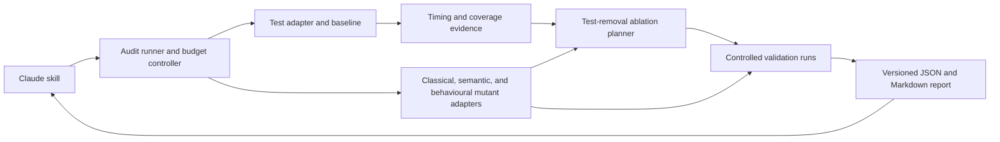

# Product requirements: Test Suite Auditor

Version 0.2 · 15 October 2026 · Status: proposed, research complete; implementation not started

## 1. Product intent

Create a Claude Code skill that audits an existing test suite and produces an evidence-backed plan to improve its speed, reliability, and fault detection. It should answer: **Which tests earn their execution cost, which behaviours lack protection, and what evidence supports changing the suite?**

As generated code becomes cheaper, tests become a durable engineering asset. A growing suite can still be slow, flaky, redundant, or weak at detecting faults. High coverage does not settle these questions. The product combines profiling, per-test coverage, classical mutation testing, experimental agent-generated faults, production-behaviour ablation, and separately controlled test-removal experiments.

The research foundation and tool comparisons are in [RESEARCH.md](RESEARCH.md). Statements below are proposed requirements and design decisions unless explicitly attributed to a source. Numerical targets are initial product hypotheses, not measured results.

## 2. Users and outcomes

Primary users are engineers and QA practitioners maintaining an agent-assisted codebase. A maintainer invokes one audit, receives ranked findings with reproducible evidence, and can choose small changes to validate. A technical lead can compare reports over time and distinguish faster execution from weakened protection.

Typical jobs:

- Find slow tests and expensive shared fixtures, then verify a refactor improves actual suite time.
- Investigate intermittent failures without disguising them with retries.
- Identify high-overlap tests and measure whether removing or consolidating them loses fault detection.
- Find covered code whose incorrect or entirely missing behaviour still passes tests, including no-op functions and null components.
- Preserve regression and contract tests needed for future implementation rewrites.

Success means a smaller maintenance burden while retaining agreed behavioural protections. Test-count reduction is not itself a success metric.

## 3. Scope and non-goals

The MVP targets Python/pytest on Linux, with pytest-cov/coverage.py for attribution and a pinned mutmut integration for classical mutations. This is a feasibility-driven default, not an assumption about the user's repositories. A framework-neutral report schema enables later JS/TS support using Stryker.

MVP includes inventory, runtime profiling, bounded repeat runs, overlap analysis, sampled classical mutations, targeted test-suite ablation, and Markdown/JSON reports. The feasibility spike also evaluates deterministic function/call deletion. A later milestone adds opt-in semantic mutation proposals and LLM-directed null-component experiments from Claude. Behavioural ablation removes production capabilities; test-suite ablation removes tests. These remain separate experiment types.

Not included: a proof of correctness, automatic deletion or quarantine of tests, unattended production changes, a universal language adapter, production fault injection, or automatic database schema rewrites. End-to-end and migration tests can be inventoried and protected; their deep mutation execution is deferred.

## 4. User experience

Proposed commands, not currently implemented:

```text
/test-suite-audit quick
/test-suite-audit deep --budget-minutes 30
/test-suite-audit semantic --max-mutants 20
/test-suite-audit ablate-behaviour --target orders --max-mutants 20
/test-suite-audit ablate-tests --candidate-group duplicate-parser-tests
```

The skill discovers the test command and adapter, explains the available evidence and budget, and invokes a deterministic runner. Existing user configuration takes precedence over discovery. Unsupported adapters produce an explicit partial report rather than fabricated measurements.

The report begins with five actionable findings, their evidence strength, likely impact, and next validation step. Each finding links to test IDs, source locations, recorded runs, and a reproduction command. Labels distinguish **measured**, **inferred**, **unverified**, and **not assessed**. No single opaque “health score” hides tradeoffs.

Example (illustrative, not measured): “Three parser tests share most covered branches. Removing two preserves the 18 observed kills in this experiment, but one has a protected incident tag. Retain that test; evaluate consolidation of the other pair. Runtime benefit remains unmeasured.”

## 5. Functional requirements

### F1. Inventory and establish a trustworthy baseline

Record repository commit and working-tree fingerprint, runner/plugin versions, dependency lock hash, configuration, test IDs including parameter cases, environment, seed, worker count, and selected scope. Inventory skipped, expected-failure, uncollected, and unsupported tests separately.

Execute a pristine baseline in an isolated workspace. Pre-existing failures or unstable baseline outcomes block confident mutation and pruning conclusions for affected scope. Record a partial report and actionable baseline failures instead. Never reset or clean the user's checkout to obtain a baseline.

### F2. Measure execution cost

Collect setup, call, and teardown timing, plus total wall time and execution topology. Profile without coverage for representative cost; instrumented runs have a separate overhead measurement. Report expensive fixtures, slow test cases, and repeated setup opportunities.

Quick mode may use one run and label it accordingly. Repeated measurements report sample count and median; tail percentiles require sufficient observations and must show their sample size. Do not add individual test durations and present that sum as parallel CI wall time. Verify proposed savings through paired full/reduced runs under comparable conditions.

### F3. Assess flakiness

Use configured CI history where available and repeated executions at a fixed revision. Separate same-order repetition from deliberate order/seed/worker changes. A passing and failing result under nominally identical conditions is an observed intermittent outcome; it does not by itself identify its cause.

Show failures/attempts, environment grouping, and uncertainty. Zero failures in a small sample is “not observed,” not “stable.” As a rough independent-trial approximation, zero failures in n runs gives a 95% upper failure-rate bound of about 3/n; correlated CI runs violate that assumption. Do not count retry success as an original pass.

Recommend fixture isolation, deterministic time/randomness, dependency control, and order-dependence investigation. Quarantine recommendations require an owner, expiry, and retained execution path; no silent disabling.

### F4. Attribute coverage and discover overlap

Build a sparse incidence matrix C[t,b] for test t and measured code element b. Support line contexts first and branch/arc attribution only when the adapter demonstrates it correctly. Keep shared fixture, import, and unknown contexts explicit.

For a line l, multiplicity is the number of distinct tests observed executing l. Report its distribution and hotspots. Pairwise Jaccard overlap is |C(a) ∩ C(b)| / |C(a) ∪ C(b)|; empty coverage sets are unknown for redundancy purposes. Use indexed candidates rather than comparing every pair in large suites.

High multiplicity and similarity prioritize investigation. They must never directly trigger deletion advice: tests may assert different contracts, values, failure paths, or integration boundaries despite executing identical lines.

### F5. Run classical mutation experiments

Reuse established mutation operators, such as boundary shifts, boolean changes, and arithmetic substitutions. Freeze a seeded, risk-stratified sample before comparing suites. Report eligible locations, sampled locations, exclusions, and per-module/operator counts. Covered-code sampling must not hide uncovered code.

Use coverage-guided tests for initial feedback, with broader confirmation for apparent survivors before making strong claims. First verify that tests actually execute the mutated copy. Apply one mutant at a time. Preserve the exact patch, selection, environment, failure signal, and run logs.

Normalize statuses: killed by reproducible test failure, survived observed scope, uncovered, invalid, timeout, infrastructure failure, flaky/ambiguous, and not run. Equivalence is a separate reviewed annotation; the model must not self-certify semantic equivalence. Unresolved statuses remain visible.

Define the audit's primary observed detection rate as K/(K+S+U), with K confirmed kills, S completed survivors, and U confirmed uncovered valid mutants. Report every denominator count and exclude invalid/timeouts/infrastructure/ambiguous/not-run from that ratio while displaying their counts beside it. If the denominator is zero, report N/A. Keep native engine scores separately labelled because conventions differ. No extrapolation to “percentage of real bugs detected.”

### F6. Add experimental agentic mutations

Use structured behavioural faults rather than arbitrary text corruption. Candidate examples: omit tenant scoping, change an inclusive boundary, swallow a meaningful exception, remove idempotency protection, or alter retry termination. Run only in disposable test environments.

Each proposal includes a minimal production-code patch, fault category, intended contract, reason the patch violates it, and a witness input or scenario. Freeze tests during evaluation. Reject modifications to test files, assertions, runner configuration, dependencies, or audit instrumentation. Parse/build/import checks reject invalid proposals; these are not kills.

Initially generate from code and reviewed requirements without showing detailed test outcomes. Add a separately labelled adversarial mode that can inspect tests and propose surviving faults. Preserve prompt, model/version, generation parameters, and exact patch: stored artifacts provide replayability even when regeneration is nondeterministic.

A survivor is a candidate gap. Confirm its behavioural deviation against a reviewed requirement, property, historical regression, or differential oracle. Separate generation and review context where useful, but do not claim that a second model establishes truth. Test-aware semantic results must not be merged into the classical mutation score.

For proposed new tests, require green on the pristine implementation, red on the confirmed fault, and a clear link to intended behaviour. Keep a held-out fault population that did not drive test generation.

### F6a. Ablate production behaviour

Temporarily remove a production capability while freezing the test suite. Support deterministic whole-function suppression and statement/call deletion first; pilot LLM-proposed null components, protocol-compatible function replacements, and targeted side-effect suppression. The research basis is extreme mutation testing and statement deletion; see [Behavioural ablation](BEHAVIOURAL_ABLATION.md) for primary sources, operator details, and a worked example.

The LLM identifies capabilities and proposes minimal interventions. A runner applies each patch to an isolated pristine baseline, checks structural validity, verifies activation, executes tests, and records outcomes. Null replacements must preserve necessary public interfaces and async/generator/context-manager protocols. They must not hard-code test answers, modify tests, or recreate the behaviour being removed. Unsupported replacements are reported explicitly.

A valid runtime exception caused by a mutant counts as a kill, with detection mechanism marked separately from a behavioural assertion. Parse/build/import-invalid patches are invalid; unrelated execution failures are infrastructure failures. Verify that mocks, alternative imports, caches, and subprocesses did not bypass the mutated implementation. A non-activated replacement is not evidence that missing behaviour went unnoticed.

Confirm important survivors with broader tests and a witness showing loss of required behaviour. Label optional, equivalent-in-scope, mock-shielded, and unresolved outcomes separately. One surviving replacement is not enough to classify a method as pseudo-tested: require covered execution and survival of every applicable replacement in a declared set, with no unresolved attempts, and retain that scope in the label.

Use module → function → side-effect experiments for prioritization, not as a monotonic search. A killed whole-function mutant can conceal an undetected missing effect. Sample fine-grained interventions beneath both killed and surviving parents, each against the pristine baseline. Store composite module interventions separately from single-effect mutations and never infer child outcomes from a parent result.

Report attempted/activated targets, replacement sets, status counts, detection mechanisms, confirmed gaps, and cost. Keep these results separate from classical and test-aware semantic scores. Evaluate deterministic deletion and LLM-directed ablation against equal-budget classical runs; measure unique reviewed gaps, incidental crashes, invalid proposals, and reviewer effort. No automatic code removal follows from a surviving ablation.

### F7. Perform controlled test-suite ablation

Construct a sparse kill matrix M[t,m] whose cells are killed, did-not-kill, or unknown. A mutation tool that stops on the first failing test supplies only partial evidence. Targeted reruns must establish additional killers where needed; unknown is never zero.

For candidate group G, compare the same frozen mutant population against full suite T and reduced suite T minus G. Measure lost kills, lost unique coverage/branches, retained requirement and historical-regression protection, and actual wall-time change. Preserve protected tests and respect declared test/fixture dependencies.

Rank candidates using estimated cost and marginal detection contribution, but present the factors separately. Greedy weighted set cover may suggest a smaller fast-feedback subset; it is a heuristic over observed evidence, not an optimal or complete behavioural specification.

A group removal must be validated as a group. If A and B both kill a mutant, either may be removable alone while deleting both loses detection. Leave-one-out results cannot authorize combined removal. Prefer consolidation or execution-tier changes before permanent deletion.

Final recommendations need a holdout evaluation using independent mutations and available historical bugs, followed by a normal complete-suite run. If the budget cannot cover these steps, label the proposal unverified and report precisely which evidence is missing.

### F8. Preserve durable behaviour and produce maintenance actions

Allow protected tags for requirements, incidents, contracts, migrations, security boundaries, and user-designated tests. Untagged does not mean unimportant: pruning still needs behavioural review. Preserve historical reproductions and minimized property-test counterexamples in the durable corpus.

Recommend a fast local/PR subset and a complete scheduled or release suite where appropriate. Do not imply that selecting fewer tests per commit justifies deleting them permanently. Classify actions as keep, investigate, speed up, consolidate, move execution tier, strengthen assertions, add property, or candidate removal.

Database migration coverage gets a separate checklist of observed evidence: old/new application compatibility where required, constraint behaviour, data preservation, and rollback or forward recovery. Unit mutation scores do not establish these properties.

## 6. Architecture and data contracts



The skill owns discovery, interpretation, and explanation. The runner owns process execution, budgets, metrics, isolation, and evidence recording. LLM prose cannot override recorded outcomes.

Core records:

- `Run`: ID, source/config/dependency fingerprints, environment, seeds, commands, scope, timestamps, budgets, status, instrumentation mode.
- `Test`: stable runner ID, parameter ID, duration observations, outcome history, contexts, protected tags.
- `Mutant`: ID, source hash, patch hash, operator/origin, contract/witness, selected tests, status, equivalence annotation, logs.
- `Observation`: test/mutant IDs, killed/did-not-kill/unknown, attempt, duration, failure signature, provenance.
- `Finding`: category, severity, confidence label, evidence IDs, assumptions, suggested action, validation state.
- `BehaviourAblation`: capability ID, granularity, replacement set/value, parent experiment, interface checks, activation evidence, witness, detection mechanism, linked mutant/run IDs.
- `TestAblation`: retained/removed IDs, frozen population, full/reduced results, lost detections, timing samples, holdout outcome.

Outputs: `report.md`, versioned `report.json`, mutant patches, and bounded logs in a local audit directory. Proposed configuration `test-suite-audit.toml` defines adapter, source/test paths, commands, budgets, protected tags, environment, and excluded paths. No cloud service is required for deterministic measurements; semantic analysis uses the configured model service and must respect repository data-sharing settings.

Use process/container isolation plus disposable checkouts. A git worktree alone is not a security boundary. Mutation workers receive no production credentials, default to restricted network access, and use disposable databases. Cancellation terminates child processes and leaves the original tree unchanged. Never publish code, logs, or findings automatically.

Cache keys include source, tests, configuration, dependency lock, tool versions, operator/prompt version, and environment fingerprint. Uncertain invalidation requires rerun. Store enough evidence to replay exact patches. Bound concurrency and disk/log usage.

## 7. Budgets and operating modes

Quick mode runs inventory, a baseline, and available timing/coverage analysis with a proposed five-minute cap. It makes no unsupported mutation or flake claims. Deep mode defaults to a 30-minute cap and a configured mutant count; semantic mode adds explicit model-token and candidate caps. Behavioural ablation has explicit target, replacement-count, time, and model-token caps, with a reserved share for independent fine-grained sampling. Limits are configurable and must be printed before work begins.

The controller reserves time for reporting and cleanup, checks remaining budgets before launching work, and terminates over-budget processes. Budget exhaustion produces a useful partial report. Existing CI telemetry can reduce reruns, but provenance and comparability must be checked. No hidden unbounded “full audit.”

Large repositories use changed-code analysis for frequent feedback and rotating stratified samples for broader audits, following the feasibility direction of [Google's industrial work](https://research.google/pubs/state-of-mutation-testing-at-google/). Scheduled execution is a future integration, not enabled by installing the skill.

## 8. Validation and success criteria

Evaluate on synthetic fixtures with known answers, then at least three consenting Python repositories with different test-suite structures. Freeze source revisions and compare against a classical-tool-only baseline at equal wall-time budgets.

Required acceptance cases:

| Case | Required outcome |
| --- | --- |
| No-op covered function; all declared replacements survive | Candidate pseudo-tested label includes replacement set, scope, and activation evidence |
| One constant survives, another is killed | Report the surviving variant without a blanket pseudo-tested label |
| Removed event publication; ID-return test passes | Confirm missing required effect with a witness and surface the scoped gap |
| Null module breaks imports or async protocol | Invalid/unsupported replacement, not behavioural detection |
| Valid null return causes downstream exception | Kill recorded with runtime-exception mechanism |
| Tests mock out mutated component | Non-activation/mock shielding recorded; no confirmed gap claim |
| Whole-function mutant killed, one side effect survives | Fine-grained gap still discovered; no parent-to-child inference |
| Same covered lines, distinct assertions | Overlap flagged; no unsupported redundancy claim |
| Two interchangeable killers | Combined deletion rejected when the last detector is lost |
| Engine stops at first kill | Unobserved cells remain unknown; targeted evidence gathered |
| Invalid/equivalent/timeout mutation | No false claim of confirmed test detection |
| Baseline flake | Relevant conclusions blocked or explicitly uncertain |
| Uncovered or unexecuted mutant | Separate visible status; not a silent survivor or kill |
| Fixture cost / parallel execution | Savings validated with wall-time measurements |
| Budget exhaustion / cancellation | Partial report, bounded shutdown, unchanged original checkout |
| Protected historical regression | Retained despite apparent coverage overlap |
| Agent changes tests/config | Patch rejected before execution |
| Dependency/config change | Relevant cached evidence invalidated |
| New test overfits visible mutants | Holdout loss reported, not hidden by improved training score |

Launch gates: all safety and metric fixtures pass; every actionable finding has provenance and a reproduction command; stable-fixture replays reproduce normalized statuses; no automatic destructive edits; and reviewed pilots show useful actionable findings on at least two of three repositories.

Evaluate, without guaranteeing, a 20% reduction in fast-feedback wall time on two pilot repositories while preserving all baseline-detected holdout faults and protected tests. Report absolute seconds, paired samples, and the fault corpus size. A smaller speed gain with stronger detection may still be valuable; do not force pruning to hit the target.

Track recommendation acceptance, confirmed-gap yield, false-positive recommendations, human review minutes, compute/model cost per accepted finding, observed intermittent-failure burden, and loss of detection after proposed reductions. Enable semantic mode beyond experimental status only if its reviewed incremental finding yield justifies its cost against equal-budget classical mutation. Publish negative results too.

## 9. Delivery sequence

1. **Feasibility spike:** pin dependencies; validate parametrized-test contexts, shared fixtures, subprocess limitations, mutation patch/status export, partial kill-matrix handling, and deterministic function/call deletion with activation checks. Exit with adapter contracts and measured overhead. If mutmut integration needs unstable internals, narrow supported versions or use explicit patch-replay execution.
2. **Audit MVP:** skill wrapper, runner, inventory, timings, flake observations, overlap, classical sampling, budgets, reproducible reports, and known-answer fixtures.
3. **Test-suite ablation pilot:** protected policies, group experiments, holdout validation, and measured fast-subset recommendations across three repositories.
4. **Semantic and behavioural-ablation experiment:** structured fault proposals, null modules and function replacements, targeted side-effect suppression, witness review, activation and protocol checks, and equal-budget comparison against deterministic deletion and classical operators. Release behind explicit opt-in if evidence supports it.
5. **Expansion:** JS/TS adapter, CI trend imports, optional scheduled audits, and richer contract/migration evidence. Prioritize based on pilot demand.

## 10. Risks and decisions still open

The central risk is optimizing against an incomplete oracle. Controls include protected behaviours, historical bugs, holdouts, explicit uncertainty, and review; none proves correctness. Equivalent mutants, selection bias, flaky environments, correlated model errors, and incomplete coverage attribution can all distort conclusions. Coarse ablation can fail through incidental crashes while missing unasserted effects; module replacements can be composite, protocol-incompatible, or bypassed by mocks. Hierarchical scheduling must not imply monotonic fault detection.

Initial decisions: Python first; a skill plus runner; existing classical engines; report-only default; separate semantic experiments; no universal score threshold. Open decisions after the spike: exact supported dependency versions, packaging/distribution, historical CI adapters, retention-policy defaults, and whether measured semantic yield merits its cost.

The product promise is practical and limited: make the evidence behind test-suite maintenance visible, repeatable, and cheaper to obtain.
